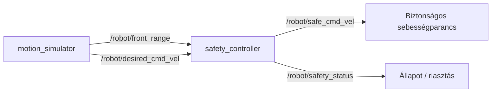

# Robotbiztonsági sebességkorlátozó (ROS 2 Humble)

## Cél

A csomag egy előre mozgó robot egyszerű, szimulált akadályelkerülési biztonsági rétegét mutatja be. A `motion_simulator` akadálytávolság-méréseket és kívánt sebességparancsokat publikál. A `safety_controller` a beérkező adatokat összeveti, majd a közeli akadályhoz igazítja az előremeneti sebességet: közvetlen közelségnél megállítja a robotot, lassítási zónában arányosan csökkenti a sebességet, biztonságos távolságnál pedig változatlanul továbbítja a parancsot.

Ez oktatási célú szimuláció. Nem hitelesített, valódi roboton használható biztonsági rendszer.

## Node-ok és topicok

| Node | Irány | Topic | Üzenettípus | Szerep |
|---|---|---|---|---|
| `motion_simulator` | publisher | `/robot/front_range` | `sensor_msgs/msg/Range` | Előre néző távolságmérő szimulált értéke, méterben |
| `motion_simulator` | publisher | `/robot/desired_cmd_vel` | `geometry_msgs/msg/Twist` | Kívánt lineáris és szögsebesség |
| `safety_controller` | subscriber | `/robot/front_range` | `sensor_msgs/msg/Range` | Akadálytávolság fogadása |
| `safety_controller` | subscriber | `/robot/desired_cmd_vel` | `geometry_msgs/msg/Twist` | Kívánt mozgás fogadása |
| `safety_controller` | publisher | `/robot/safe_cmd_vel` | `geometry_msgs/msg/Twist` | Biztonsági szabály által korlátozott sebességparancs |
| `safety_controller` | publisher | `/robot/safety_status` | `std_msgs/msg/String` | Állapotváltáskor `CLEAR`, `SLOW` vagy `STOP` üzenet |

## Működési logika

- **CLEAR:** ha a mért távolság legalább 1,50 m, az előremeneti sebesség változatlanul továbbhalad.
- **SLOW:** 0,65 m és 1,50 m között az előremeneti sebesség lineárisan, a távolsághoz arányosan csökken.
- **STOP:** 0,65 m-en vagy az alatt az előremeneti sebesség 0 m/s.
- **Érvénytelen távolság:** nem véges vagy negatív értéknél a rendszer az előremeneti mozgás leállításával hibabiztosan viselkedik.

A vezérlő minden új bemeneti mérésnél kiadja a korlátozott sebességparancsot. Szöveges státuszt csak a `CLEAR`, `SLOW`, `STOP` mód változásakor publikál.

## Node–topic diagram



A forrásdiagram: `docs/node_topic_diagram.mmd`.

## Követelmények

- Ubuntu 22.04 és ROS 2 Humble
- Python 3, `colcon`, `rosdep`
- ROS 2 csomagok: `rclpy`, `sensor_msgs`, `geometry_msgs`, `std_msgs`, `launch`, `launch_ros`

## Build

A következő parancsok feltételezik a ROS 2 Humble telepítését, és hogy a repository a `~/ros2_ws/src/csi_f7q_robotprog` útvonalra került.

```bash
source /opt/ros/humble/setup.bash
mkdir -p ~/ros2_ws/src
cd ~/ros2_ws/src
git clone https://github.com/kevinhun112-cell/csi_f7q_robotprog.git
cd ~/ros2_ws
rosdep install --from-paths src --ignore-src -r -y
colcon build --packages-select robot_biztonsag --symlink-install
source install/setup.bash
```

## Futtatás és ellenőrzés

```bash
ros2 launch robot_biztonsag robot_safety.launch.py
```

Másik terminálban (a ROS és a munkaterület beolvasása után):

```bash
ros2 node list
ros2 topic list
ros2 topic echo /robot/front_range
ros2 topic echo /robot/desired_cmd_vel
ros2 topic echo /robot/safe_cmd_vel
ros2 topic echo /robot/safety_status
```

A `safe_cmd_vel` előremeneti sebessége az akadály közeledésekor csökken, majd nullára vált. A terminál a módváltásokat is megjeleníti.

## Paraméterek

A launch fájlban és a node paramétereivel állítható:

- `publish_rate_hz`: szimulált mintavétel/publikálás (alapérték: 2 Hz).
- `stop_distance_m`: megállási határ (alapérték: 0,65 m).
- `full_speed_distance_m`: ettől a távolságtól felfelé teljes sebesség (alapérték: 1,50 m).

A két távolságparaméternek teljesítenie kell a `0 < stop_distance_m < full_speed_distance_m` feltételt.

## A tiszta sebességlogika tesztelése ROS nélkül

A sebességszámítás leválasztott, ezért egyszerű egységtesztek futtathatók ROS 2 telepítés nélkül is:

```bash
python3 -m unittest discover -s test -v
```

## Beadás előtti ellenőrzőlista

- [ ] `colcon build --packages-select robot_biztonsag --symlink-install` sikeres ROS 2 Humble környezetben.
- [ ] A launch fájl mindkét node-ot elindítja.
- [ ] A `CLEAR`, `SLOW` és `STOP` állapot legalább egyszer megjelenik a szimuláció futása közben.
- [ ] Készül képernyőkép a futó programról és a topic kimenetéről.
- [ ] A GitHub repository neve megfelel az oktatói névkonvenciónak: `vvv_nnn_opcionalis`, kisbetűkkel.
- [ ] A README parancsait tiszta terminálból is ellenőrzöd.

## Korlátok és ellenőrzési állapot

A Python-szintaxis, a csomag XML-metaadata és a ROS-tól független biztonsági logika egységtesztjei automatizáltan ellenőrizhetők. A tényleges ROS 2 build/futtatás csak ROS 2 Humble környezetben igazolható. A repository nem tartalmaz kitalált futási képernyőképet vagy nem igazolt builderedményt.
